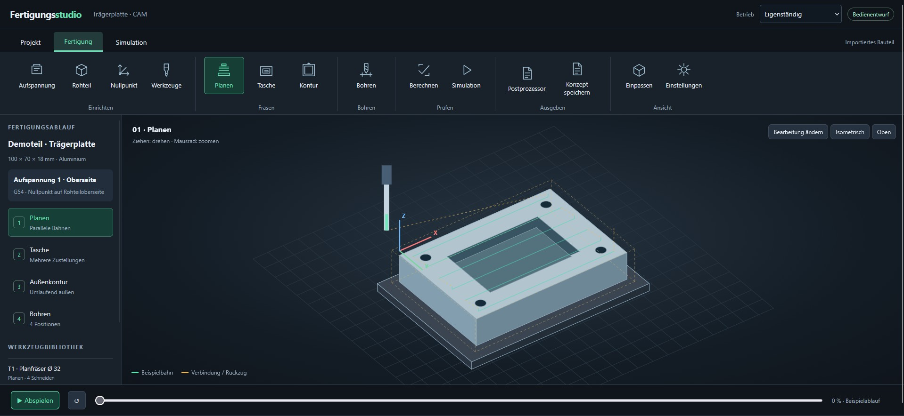

# Fertigungsstudio CAM

[Deutsch](README.md) · **English**

A proposed community CAM project with a shared core, a standalone application
and optional integration into SolidCraft. Clear workflows and a multilingual
interface are central requirements. Fertigungsstudio is a working name, not
an official SolidCraft project.

**Current status: interactive interface prototype and first Rust data contracts (on a development branch), not working CAM.**

*Interface concept, 24 November 2026. Paths are illustrative, not calculated
or verified machine movements.*

Open `prototype/fertigungsstudio-kacheln.html` in a browser. No installation or
server is required. The current prototype is in German. It demonstrates ribbon
tiles, an operation tree, a rotatable example part, schematic tool movement,
contextual parameters and settings dialogs. The integration selector is a mockup.

There is no CAD import, machining toolpath calculation, stock-removal or
collision verification, usable NC output, or SolidCraft integration. Do not
use this prototype to control machinery.

## Direction

- One UI-independent CAM core for both application modes.
- An optional CAD integration that leaves CAD-only installations lightweight.
- A clear ribbon, operation tree, large viewport and contextual parameter editor.
- Central application settings and a saved per-user language choice.
- German and English first; additional languages through translation catalogs.
- Separate paths for **3-/5-axis milling, turning and laser cutting** from the beginning. The first implemented machining scope will be 3-axis facing, then contours, pockets and drilling. Indexed 3+2 and simultaneous 5-axis work require later kinematics and collision validation.

The intended application language is Rust. HTML/JavaScript is only a design
prototype. The development branch contains initial Rust types for machines,
tools, setups and operations, but no cutting-path calculation. See
[docs/ARCHITECTURE.md](docs/ARCHITECTURE.md). The SolidCraft integration route remains to be researched; no
plugin capability or upstream approval is assumed. All design work must be
original or properly licensed, without copied vendor interfaces or assets.

## Join the development

We welcome future collaborators in Rust, interface development, machining,
verification, post processors and translations. See [TASKS.md](TASKS.md) for
bounded initial work and [CONTRIBUTING.md](CONTRIBUTING.md) for the proposed workflow.
No tasks have been assigned yet.

Multilingual requirements are recorded in [docs/multilingual.md](docs/multilingual.md).
The prototype does not yet use translation catalogs. Machine output, project
data and command identifiers must remain independent of the display language.

## License and participation

The project's own code, documentation and symbols in this package are licensed
under the [Apache License 2.0](LICENSE). See [NOTICE](NOTICE) for provenance.
The license does not grant trademark rights in the project name or logo.
Material released under Apache 2.0 remains available under those terms; a later
license change cannot revoke those permissions.
No SolidCraft/CamCraft code or earlier Rust patches are bundled.
The [repository](https://github.com/harry3452/Fertigungsstudio-cam) is public.
Browse the [open issues](https://github.com/harry3452/Fertigungsstudio-cam/issues)
and join a task discussion if you would like to contribute.
