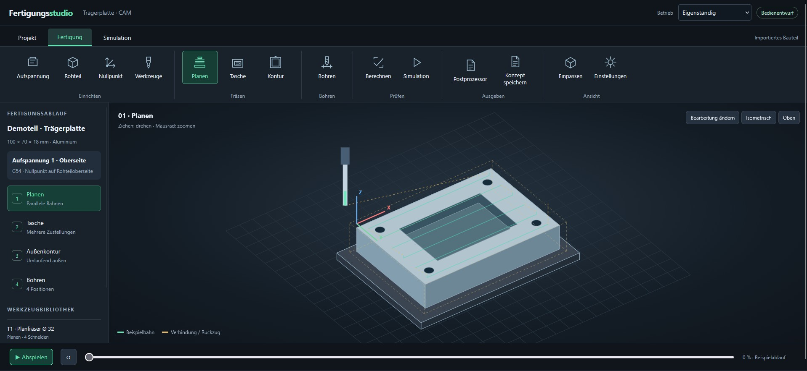

# Fertigungsstudio CAM

**Deutsch** · [English](README.en.md)

Ein gemeinschaftlich zu entwickelndes CAM mit zwei geplanten Zugängen: als
eigenständiges Programm und optional direkt in SolidCraft. Die Oberfläche soll
übersichtlich, mehrsprachig und auf den Arbeitsablauf in der Werkstatt ausgelegt sein.

**Status: Oberflächenprototyp und erster experimenteller Rust-Kern. Noch kein nutzbares CAM.**
Fertigungsstudio ist ein Arbeitsname und kein offizielles SolidCraft-Projekt.

*Bedienentwurf vom 24. November 2026. Gezeigt werden illustrative Bahnen,
keine berechneten oder geprüften Maschinenbewegungen.*

## Vorschau starten

`prototype/fertigungsstudio-kacheln.html` im Browser öffnen. Keine Installation,
kein Server und keine zusätzlichen Pakete nötig. Die Anzeige ist derzeit deutsch.

Ausprobierbar sind gruppierte Symbolkacheln, Bearbeitungsauswahl, eine drehbare
Beispielplatte, schematische Werkzeugbewegungen und Dialoge für Aufspannung,
Darstellung und Ausgabe. Die Ansicht kann zwischen integriertem und
eigenständigem Betrieb umgeschaltet werden; das ist nur eine Darstellung.

Der erste Rust-Kern berechnet eingeschränkte Planfräsbahnen für rechteckige
Rohblöcke. Über „Rust-Demo“ zeigt die Vorschau einen berechneten Datensatz;
weitere Rust-Bahnen können als JSON-Datei geladen werden. Mit
`cargo run --locked --offline --example preview_server` startet eine lokale
Live-Vorschau: gedruckte Adresse öffnen, „Live-Planfräsen“ wählen und Maße eingeben.
Eine Kollisionsprüfung ist noch nicht vorhanden.
Aufbau, Prüfungen und Grenzen: [Erster Kernbaustein](docs/core-first-step.md).

Nicht vorhanden: realer CAD-Import, allgemeine Werkzeugwegberechnung, Materialabtrags-
und Kollisionsprüfung, geprüfter NC-Export oder eine SolidCraft-Anbindung.
Der Entwurf darf nicht zur Steuerung einer Maschine verwendet werden.

## Was wir bauen möchten

- Einen gemeinsamen, von der Oberfläche unabhängigen CAM-Kern.
- Ein eigenständiges Programm und eine optionale SolidCraft-Anbindung.
- Eine große Modellansicht, einen Bearbeitungsbaum links und oben klar
  beschriftete Symbolkacheln in Funktionsgruppen.
- Einen zentralen Einstellungsdialog und gezielt einblendbare Bearbeitungsparameter.
- Mehrsprachigkeit von Beginn an: zunächst Deutsch und Englisch, weitere
  Sprachen über Übersetzungsdateien. Die Sprache ist eine Nutzereinstellung.
- Als ersten Bearbeitungsumfang 3-Achs-Planen, Konturen, Taschen und Bohren.

Der Integrationsweg muss noch untersucht werden. Weder ein funktionierendes
SolidCraft-Plugin noch eine Zustimmung der SolidCraft-Maintainer wird behauptet.
Die spätere Anwendung soll in Rust entstehen; HTML/JavaScript dienen hier nur
zum Erproben des Bedienkonzepts. Funktionen werden eigenständig gestaltet;
Herstellercode, Symbole oder Oberflächen anderer CAD-Produkte werden nicht kopiert.

## Mitentwickler gesucht

Wir möchten die Entwicklung gemeinsam tragen. Gesucht werden Menschen, die
Rust programmieren, Oberflächen entwickeln, CAM-Verfahren verstehen,
Postprozessoren prüfen oder Übersetzungen und Tests beitragen möchten.

Konkrete Einstiegspakete stehen in [TASKS.md](TASKS.md), die Zusammenarbeit in
[CONTRIBUTING.md](CONTRIBUTING.md). Noch keine Aufgaben sind vergeben.

## Mehrsprachigkeit

[docs/multilingual.md](docs/multilingual.md) hält die Anforderungen fest.
Die spätere Oberfläche darf Texte nicht fest im Programm verteilen.
G-Code, Projektformate und öffentliche Befehlskennungen bleiben sprachunabhängig.
Die Übersetzungsanbindung ist im Prototyp noch nicht implementiert.

## Lizenz und Veröffentlichung

Der eigene Code, die Dokumentation und die eigenen Symbole dieses Pakets stehen
unter der [Apache License 2.0](LICENSE). Hinweise zur Herkunft stehen in
[NOTICE](NOTICE). Die Lizenz erteilt keine Markenrechte am Projektnamen oder Logo.
Bereits unter Apache 2.0 veröffentlichte Bestandteile bleiben unter diesen
Bedingungen nutzbar; eine spätere andere Lizenz gilt nicht rückwirkend.
SolidCraft- oder CamCraft-Code und die bisherigen Rust-Patches sind hier nicht
enthalten. Deren Wiederverwendung muss separat geprüft werden.

Das [GitHub-Repository](https://github.com/harry3452/Fertigungsstudio-cam) ist
öffentlich. Interessierte können die [offenen Aufgaben](https://github.com/harry3452/Fertigungsstudio-cam/issues)
ansehen und sich dort zur Mitarbeit melden.
